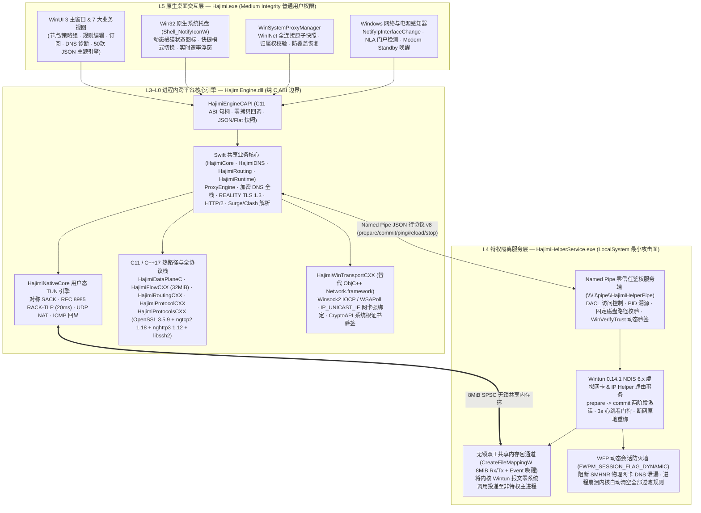
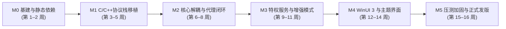

# 哈基米 (Hajimi) Windows 端实施方案与架构演进规划

> **基准审查版本**：`v0.1.0-Build73`（macOS 原生多模块基线）  
> **目标平台**：Windows 10 21H2 (Build 19044+) / Windows 11（原生支持 `x86_64` 与 `arm64` 双架构）  
> **核心目标**：在 **100% 继承哈基米四大刚性架构原则**（标准协议栈、进程内零外部代理子进程、C/C++ 热路径下沉、特权最小化与故障自愈）的前提下，最大化复用现有 13.3 万行高可靠源码与回归测试资产，交付具备原生高帧率体验、零 DNS 泄漏、崩溃秒级自愈的 Windows 客户端。

---

## 一、项目现状深度审查报告 (Project Audit)

### 1.1 项目核心架构基因（Windows 端必须继承的刚性约束）

通过对 `README.md`、`项目架构与维护文档.md`、`PROTOCOL_STACK_AUDIT.md` 及全仓源码的交叉审计，哈基米之所以在安全性、吞吐上限与首包时延（TTFB）上具备显著优势，源于以下四项不可妥协的设计准则：

1. **100% 标准协议栈与现代密码学单基线**：全栈建立在 OpenSSL 3.5.9 LTS（原生支持 NIST FIPS 203 `ML-KEM-768` 与 QUIC TLS API）、`ngtcp2 1.18.0`（QUIC v1/v2 + BBRv2 + ECN）、`nghttp3 1.12.0` 与锁定安全补丁的 `libssh2` 之上；严禁引入非标准 DPI 分片篡改或手写密码学原语。
2. **零外部代理内核子进程（In-Process Native Engine）**：HTTP/SOCKS5 入站、用户态 TUN TCP/IP 重组、预编译路由树、加密 DNS 引擎及 15 种出站协议全部在进程内原生运行，无 `xray-core` / `sing-box` / `mihomo` 子进程拉起开销或孤儿进程风险。
3. **热路径下沉与有界内存预算**：逐包校验和与头部解析下沉至 C11（`HajimiDataPlaneC`），流重组（全局 `32 MiB` 原子上限）、无锁路由后缀树、单遍 SWAR 掩码与协议编解码下沉至 C++17。
4. **特权最小化与确定性自愈（Fail-Closed & Self-Healing）**：特权守护进程仅负责虚拟网卡、路由与系统 DNS 事务，具备两阶段提交（`prepare` -> `commit`）、3 秒心跳断连自动回滚与外部配置归属权校验（绝不覆盖其他代理软件设置，绝不在崩溃后留下断网黑洞）。

---

### 1.2 全仓代码规模与模块耦合度盘点

经全仓静态扫描（剔除 `VendorInclude` 头文件与静态主题 JSON），当前项目包含 **20 个原生 Target、242 个源码文件、共计 133,528 行核心代码**。按跨平台可移植性划分为三级（Tier 1–Tier 3）：

| 移植分级 | 模块名称 | 语言 | 文件数 | 代码行数 | 当前平台依赖审计 | Windows 端处置策略 |
| :--- | :--- | :--- | ---: | ---: | :--- | :--- |
| **Tier 1：直接复用 / 极薄头文件垫片**<br>*(共 8 模块，8,193 行 + 50 款主题资源)* | `HajimiFlowCXX` | C++17 | 2 | 833 | **零系统依赖**（纯 C++17 标准库，32 MiB 队列/SACK/RTO/BDP） | 原封不动直接编译 |
| | `HajimiRoutingCXX` | C++17 | 3 | 1,116 | 仅 `<arpa/inet.h>`（`inet_pton`） | 10 行 `<winsock2.h>` / `<ws2tcpip.h>` 兼容宏直编 |
| | `HajimiProtocolCXX` | C++17 | 2 | 2,812 | `-fno-exceptions -fno-rtti`，仅 `<arpa/inet.h>` | 同上，直接静态编译 |
| | `HajimiDataPlaneC` | C11 | 2 | 1,128 | `<arpa/inet.h>`、GCC `__builtin_bswap64` / `__uint128_t`、ARM64 NEON | 补充 MSVC/Clang-CL `_byteswap_uint64` 与 AVX2/SSE2 校验和分支 |
| | `HajimiRouting` | Swift | 3 | 635 | 纯 `Foundation` | Swift on Windows 直接编译（扩展 `.exe` 进程名归一化） |
| | `HajimiRuntime` + `*TestSupport` | Swift | 10 | 1,335 | 纯 `Foundation` 状态机 | Swift on Windows 直接编译 |
| | `HajimiIPC` *(协议模型层)* | Swift | 1 | ~200 | `PrivilegedHelperProtocol.swift` 为纯 `Foundation` `Codable` | 复用全部状态机与请求/响应契约；拆分替换 `SCM_RIGHTS` 文件 |
| | `Resources/Themes` | JSON | 60+ | — | 50 款 `.hajimitheme.json` 色彩/圆角/布局令牌 | Windows UI 主题引擎 100% 原生解析复用 |
| **Tier 2：平台抽象解耦后跨平台共享**<br>*(共 4 模块，90,890 行，占全仓 68.1%)* | `HajimiProtocolsCXX` | C++17 | 51 | 20,210 | 49 个文件纯标准 C++17 + OpenSSL 3.5；仅 `QUICTransport.cpp`（POSIX Socket/`kqueue`/`SecTrust`）、`SSH.cpp`（`stat`/`open`）及 `<arpa/inet.h>` 耦合 POSIX/Apple | 抽离 `SocketOps` 兼容层，适配 Winsock2、`WSAPoll`/IOCP、Windows `CryptoAPI` 根证书验签与 UTF-8 宽字符路径 |
| | `HajimiDNS` | Swift | 8 | 5,696 | 7 个文件纯 `Foundation`；仅 `DNSMessageInspection.swift` 含 `import Darwin` | 替换 1 处 `Darwin` 字节序/地址转换，100% 跨平台共享 |
| | `HajimiCore` | Swift | 72 | 60,198 | 耦合 `Network.framework`、`CryptoKit`、`CommonCrypto`、`Compression`、`Darwin` 及 ObjC++ 桥接层 | 抽离 `TransportRuntime` 协议、OpenSSL 3.5 密码学垫片、`zlib-ng`/`brotli` 压缩垫片与进程端口查询接口 |
| | `HajimiNativeCore` | Swift | 7 | 4,786 | 耦合 `utun` 文件描述符、`DispatchSourceRead/Write` 与 4 字节 `AF_INET` 帧头 | 抽离 `PacketTunnelChannel` 协议，屏蔽 `utun` 4B 前缀与 Wintun 裸 L3 环形缓冲区差异 |
| **Tier 3：Windows 原生重构模块**<br>*(共 8 模块，34,445 行，占全仓 25.8%)* | `HajimiProxyRuntime` + `HajimiCXXProtocolBridge` | ObjC++ | 4 | 2,385 | 强依赖 Objective-C ARC、`OS_dispatch_data`、`nw_connection_t` | 重构为纯 C++17 + C ABI 的 `HajimiWinTransportCXX`（Winsock2 IOCP + OpenSSL 3.5 TLS + 网卡强绑定） |
| | `HajimiHelper` + `UnixFDPassing` | Swift | 7 | 3,952 | macOS LaunchDaemon、`utun`、`route`/`ifconfig`/`networksetup`、`SecCode` | 重构为 Windows 系统服务 `HajimiHelperService.exe`（Named Pipe + `WinVerifyTrust` + `Wintun` + `WFP` + `iphlpapi`） |
| | `HajimiApp` + `HajimiUIComponents` + `HajimiDiagnosticsUI` + `HajimiMacOSObjC` | Swift / ObjC | 72 | 28,108 | 强绑定 `AppKit`、`SystemConfiguration`、`osascript`/`networksetup`、`NEVPNManager` | 采用 **WinUI 3 (Windows App SDK)** 原生构建桌面端、系统托盘、Direct2D 流量图与 WinINet 系统代理管理器 |

---

### 1.3 审查发现的五大跨平台关键阻塞点与隐患预警

在深入审查代码细节时，识别出以下 5 个必须在架构设计阶段前置解决的工程痛点：

1. **核心业务资产高度集中在 Swift 层（`HajimiCore` + `HajimiDNS` + `HajimiNativeCore` 合计 7.07 万行）**：
   - 许多方案容易误判“只需移植 `HajimiProtocolsCXX` 即可”，但实际上 **Surge `.conf` / Clash YAML / 14 种分享链接解析器、XTLS REALITY TLS 1.3（含 Chrome 指纹与 RFC 8879 证书解压）、HTTP/2（16 MiB 动态 BDP 窗口 + DFA 霍夫曼）、WebSocket/XHTTP/mKCP/Mux.Cool 载体、前沿加密 DNS 全栈（DoH/DoT/DoQ/ODoH/DDR/SOA 负缓存/DE-R/Happy Eyeballs v3）以及用户态 TCP SACK/RACK-TLP 状态机** 全部位于 Swift 模块中。若抛弃 Swift 层完全用 C++ 重写，不仅工作量高达 9–12 个月，更会导致双端协议行为与安全基线彻底分裂。
2. **Windows 中文/Unicode 用户目录路径窄字符失效风险（高危必现）**：
   - `Sources/HajimiProtocolsCXX/SSH.cpp`（`::stat` / `::open` 读取私钥）与 `QUICTransport.cpp`（`std::ifstream(caPath)` 与 `SSL_CTX_load_verify_locations`）直接将 UTF-8 `std::string` 传给 C/C++ 窄字符文件 API。在 Windows 下（例如中文用户名路径 `C:\Users\云龙\AppData\...`），窄字符 API 默认按本地 ANSI 代码页（GBK）解析，会导致证书与私钥加载 100% 失败。必须统一通过 UTF-8 -> UTF-16 转换（`std::filesystem::u8path` / `MultiByteToWideChar` + `_wfopen` / `BIO_new_fp`）处理。
3. **`utun` 4 字节协议族前缀硬编码假设**：
   - macOS `utun` 读写报文前带有 4 字节网络序 `AF_INET` / `AF_INET6` 头（`hajimi_write_frame_prefix`，`NativeTunnel.readBuffer` 长度为 `65_540`）；而 Windows `Wintun` 驱动直接收发**纯三层（Layer-3）IPv4/IPv6 裸报文（0 字节前缀）**。数据面通道抽象必须在零额外拷贝的前提下支持 `framePrefixLength = 0 | 4` 偏移量配置。
4. **双密码学库符号冲突与体积膨胀隐患**：
   - `HajimiCore` 当前调用 Apple `CryptoKit` 与 `CommonCrypto`，若在 Windows 端直接引入开源 `swift-crypto`，其内置的 `CCryptoBoringSSL` 会与项目已静态链接的 **OpenSSL 3.5.9 LTS** 共存，引发符号污染与数十 MB 体积膨胀。应直接将 Swift 层密码学原语桥接至 `HajimiProtocolsCXX` 现有的 OpenSSL 3.5.9 `EVP` C ABI。
5. **Winsock2 特有网络语义陷阱**：
   - **UDP `WSAECONNRESET` (10054) 假性断流**：Windows UDP Socket 收到对端 ICMP Port Unreachable 后，后续 `recvfrom`/`WSARecvMsg` 会直接报错 `WSAECONNRESET`，导致 QUIC / WireGuard / DoQ 套接字意外中断，必须在建连时通过 `WSAIoctl(..., SIO_UDP_CONNRESET, &FALSE)` 显式关闭。
   - **物理网卡绑定字节序不对称**：Winsock2 的 `IP_UNICAST_IF` 要求传入**网络字节序** `htonl(ifIndex)`，而 `IPV6_UNICAST_IF` 要求传入**主机字节序** `ifIndex`，封装时必须严格区分并辅以单元测试校验。
   - **Windows SMHNR 多宿主并发 DNS 泄漏**：Windows 默认向所有活动网卡并发发送 DNS 请求，仅靠修改 TUN 网卡 DNS 无法阻止物理网卡泄漏，必须配合 **WFP（Windows Filtering Platform）动态会话过滤器** 在内核态拦截非授权端口 53/853 流量。

---

## 二、Windows 端总体技术选型与架构决策 (ADR)

### 2.1 核心引擎技术路线对比

| 评估维度 | 方案 A（推荐）：Swift 6 on Windows 共享核心 (`HajimiEngine.dll`) + C11/C++17 原生栈 | 方案 B：全量下沉重写为纯 C++20 引擎 (`libhajimi_core`) | 方案 C（否决）：外部 Go 内核套壳 (`sing-box` / `mihomo`) |
| :--- | :--- | :--- | :--- |
| **核心代码复用率** | **> 73%（直接共享 ~9.9 万行 C/C++/Swift 核心源码）** | ~19.5%（仅能复用 2.6 万行 C/C++，需重写 7.1 万行 Swift） | ~0%（核心逻辑完全推倒） |
| **双端特性与安全同步** | **单一事实来源（Single Source of Truth）**，macOS/Win 同步演进 | 双语言维护或被迫反向重构 macOS 端，回归风险极高 | 彻底违背项目“零外部子进程 + 自研标准栈”基因 |
| **工具链成熟度** | Swift 6 官方 Windows (`x86_64`/`arm64` MSVC ABI) 已在 Arc Browser 等大型桌面商业软件大规模生产验证 | MSVC / Clang-CL 原生支持，最为传统 | Go 工具链成熟，但存在跨进程 IPC 与 GC 抖动 |
| **研发周期估算** | **14–16 周（约 3.5–4 个月）达到生产级发版** | 36–48 周（9–12 个月），极易在 TLS/DNS/TCP 边界引入 Bug | 不适用 |
| **综合结论** | **采用**。通过消除 `HajimiCore` 内的 ObjC++ 与 Apple 私有框架耦合，编译为标准 C ABI 动态库 `HajimiEngine.dll` | 仅作为远期局部极致热点下沉手段，不做大爆炸重写 | **明确否决** |

### 2.2 桌面 GUI 框架选型对比

| 评估维度 | 方案 1（推荐）：WinUI 3 (Windows App SDK 1.6+, C# / .NET 8) | 方案 2：Qt 6 (C++ / QML) | 方案 3：Tauri v2 (WebView2 + 前端框架) |
| :--- | :--- | :--- | :--- |
| **原生视觉与系统融合** | **原生 Fluent Design / Mica / Acrylic 材质**、原生高刷 DirectComposition、Per-Monitor DPI v2 完美缩放 | 跨平台自绘，需大量定制才能贴近 Win11 原生质感 | 依赖 Edge WebView2，窗口冷启动与原生控件菜单有割裂感 |
| **内存与后台驻留开销** | **极低**（主界面关闭驻留托盘时工作集可压至 `15–25 MB`，打开界面 `45–70 MB`） | 中等（`50–90 MB`，携带数十 MB Qt 动态库） | 偏高（打开主窗口常驻 `120–250 MB` Chromium 渲染进程） |
| **50 款内置主题兼容性** | 极佳：通过 `ResourceDictionary` 动态绑定 `.hajimitheme.json` 十六进制色值与圆角令牌 | 良好（QML 属性绑定） | 极佳（CSS 变量），但牺牲原生低内存优势 |
| **高频流量图与诊断渲染** | **Win2D / SkiaSharp 硬件加速画布**，轻松实现 60/120fps 零卡顿实时波形 | QQuickPaintedItem / SceneGraph | Canvas / SVG |
| **许可证与分发友好度** | MIT / 微软官方运行时，支持 x64/ARM64 独立打包（Self-Contained） | LGPLv3 动态链接合规约束较繁琐 | MIT / Apache-2.0 |

> [!IMPORTANT]
> **最终架构选型定案（已确认）**：Windows 端核心引擎采用 **100% 纯 C11/C++17 原生架构**（直接共享全仓 ~2.6 万行 C11/C++17 数据面、路由后缀树与 15 种出站协议栈，并以纯 C++17 实现异步传输运行时 `HajimiWinTransportCXX` 与代理/DNS/TUN 调度导出纯 C ABI `HajimiEngine.dll`，**零 Swift Windows 运行时依赖**，且保持现有 macOS Swift 构建链 100% 零改动兼容），配合 **WinUI 3 原生桌面壳层（`Hajimi.exe`）+ C++17 零信任 Windows 特权系统服务（`HajimiHelperService.exe`）** 组成四层正交架构。

### 当前里程碑落地进度看板

| 阶段 | 里程碑名称 | 状态 | 核心交付物索引 |
| :---: | :--- | :---: | :--- |
| **M0** | 跨平台构建基建、锁哈希静态依赖与 L0 适配 | **已完成代码落地** | `CMakeLists.txt`、`CMakePresets.json`、`scripts/build_native_core.ps1`、`Sources/HajimiPlatformC`、`SmokeTests/DataPlaneMain.c` |
| **M1** | C++17 全协议栈移植、`HajimiWinTransportCXX` 与 CI | **已完成代码落地** | `Sources/HajimiProtocolsCXX/PlatformCompat.hpp`、`QUICTransport.cpp`、`SSH.cpp`、`Sources/HajimiWinTransportCXX`、`SmokeTests/WinTransportMain.cpp`、`scripts/test_win_offline_suite.ps1`、`.github/workflows/build-and-release-windows.yml` |
| **M2** | C++17 代理核心调度、加密 DNS、`HajimiEngine.dll` 与系统代理 | **已完成代码落地** | `Sources/HajimiEngineCAPI/include/HajimiEngineCAPI.h`、`ProfileConfigParser.cpp`、`EncryptedDnsAndFakeIp.cpp`、`WinSystemProxyAndProcess.cpp`、`UserspacePacketTunnel.cpp`、`HajimiEngineCAPI.cpp`、`Windows/HajimiCli/hajimi_cli_main.cpp` |
| **M3** | `HajimiHelperService.exe` + Wintun 共享内存环 + WFP 防泄漏 | **已完成代码落地** | `Sources/HajimiPlatformC/include/HajimiShmRing.h`、`Windows/HajimiHelperService/HelperProtocolV8.cpp`、`WintunSessionBridge.cpp`、`RouteAndDnsTransaction.cpp`（含 `WfpLeakGuard`）、`ServiceMain.cpp` |
| **M4** | WinUI 3 原生桌面端、50 款 JSON 主题引擎与诊断中心 | **已完成代码落地** | `Windows/HajimiWinApp/HajimiWinApp.csproj`、`Interop/HajimiEngineInterop.cs`、`Themes/HajimiWinThemeEngine.cs`、`Controls/TrafficWaveformCanvas.cs`、`SystemIntegration/*`、`MainWindow.xaml(.cs)` |
| **M5** | 性能压测、红队安全加固与 Inno Setup / 便携版双架构发布 | **已完成代码落地** | `SmokeTests/EngineLoopbackMain.cpp`、`Windows/Installer/Hajimi.iss`、`Windows/Installer/PortableLauncher/PortableLauncher.cpp`、`scripts/build_native_core.ps1`（含 Wintun 0.14.1 锁哈希校验）、`.github/workflows/build-and-release-windows.yml` |

---

### 2.3 Windows 端整体架构拓扑图



---

### 2.4 多平台同仓（Monorepo）目录规划

保持现有 macOS 构建链（`Package.swift` + `Makefile`）**100% 零回归兼容**，新增平台解耦目录与 `Windows/` 工程树：

```text
hajimi/
├── Package.swift                        # 保持 macOS 构建兼容，并为HajimiCore等增加 Windows 条件编译分支
├── CMakeLists.txt                       # 新增：跨平台 C11/C++17/Swift-Win32 统一构建根工程
├── CMakePresets.json                    # 新增：win-x64-release / win-arm64-release 编译预设
├── Sources/
│   ├── HajimiPlatformC/                 # 新增：跨平台字节序、UTF-8/UTF-16 路径、压缩(zlib/brotli)、OpenSSL C 垫片
│   ├── HajimiWinTransportCXX/           # 新增：Winsock2 IOCP + OpenSSL TLS + CryptoAPI 传输运行时（对标 HajimiProxyRuntime）
│   ├── HajimiEngineCAPI/                # 新增：面向 WinUI 3 与自动化测试导出的纯 C ABI 接口层
│   ├── HajimiDataPlaneC/                # 共享（补充 MSVC/x86_64 SIMD 宏）
│   ├── HajimiFlowCXX/                   # 100% 原样共享
│   ├── HajimiProtocolCXX/               # 共享（头文件兼容宏）
│   ├── HajimiRoutingCXX/                # 共享（头文件兼容宏）
│   ├── HajimiProtocolsCXX/              # 共享（抽象 QUICTransport / SSH 平台系统调用）
│   ├── HajimiDNS/                       # 共享
│   ├── HajimiRouting/                   # 共享
│   ├── HajimiRuntime/                   # 共享
│   ├── HajimiCore/                      # 共享（通过 #if canImport(Network) / PlatformTransport 解耦）
│   ├── HajimiNativeCore/                # 共享（通过 PacketTunnelChannel 协议适配 utun 与 Wintun 共享内存环）
│   └── ... (保留 macOS 专属模块 HajimiApp / HajimiHelper / HajimiMacOSObjC 等)
├── Windows/
│   ├── HajimiHelperService/             # C++17 原生 Windows NT 服务（无 Swift 运行时依赖，体积 < 1.5 MB，极速启动）
│   │   ├── ServiceMain.cpp              # SCM 服务控制管理器生命周期与故障恢复策略
│   │   ├── NamedPipeAuthServer.cpp      # DACL + GetNamedPipeClientProcessId + WinVerifyTrust 严格验签
│   │   ├── WintunSessionBridge.cpp      # wintun.dll 动态验签加载与 8 MiB SPSC 共享内存环桥接
│   │   ├── RouteAndDNSTransaction.cpp   # CreateIpForwardEntry2 分裂路由与 SetInterfaceDnsSettings 事务
│   │   └── WfpLeakGuard.cpp             # FWPM_SESSION_FLAG_DYNAMIC 动态防 DNS 泄漏与防环回规则
│   ├── HajimiWinApp/                    # WinUI 3 (.NET 8) 原生客户端工程
│   │   ├── Interop/                     # LibraryImport 强类型绑定 HajimiEngine.dll C ABI
│   │   ├── Themes/                      # .hajimitheme.json 动态解析与 WinUI ResourceDictionary 热切换引擎
│   │   ├── SystemIntegration/           # WinSystemProxyManager / TrayIconService / NetworkPowerWatcher
│   │   ├── Views/                       # 概览仪表盘、策略组、规则编辑器、订阅管理、加密 DNS 与五阶段诊断视图
│   │   └── Controls/                    # Win2D 60fps 实时流量波形组件、Bento 卡片容器
│   └── Installer/
│       ├── Hajimi.iss                   # Inno Setup x64/ARM64 安装脚本（含服务注册、卸载清理校验）
│       └── PortableLauncher/            # 绿色免安装模式启动引导（按需单进程 UAC 提权支持）
└── scripts/
    ├── build_native_core.ps1            # Windows 端 OpenSSL 3.5.9 / ngtcp2 / nghttp3 / libssh2 / zlib / brotli 锁哈希静态构建脚本
    └── test_win_offline_suite.ps1       # Windows 端零宿主机副作用全套离线回归门禁脚本
```

---

## 三、核心子系统 Windows 端详细实施方案

### 3.1 跨平台公共内核解耦方案（零破坏演进）

#### 3.1.1 传输层与异步调度抽象（消除 `Network.framework` 与 ObjC++ 硬编码）
当前 `HajimiCore` 内部有 20 余个文件直接 `import Network` 或调用 Objective-C++ `HJNetworkStream` / `HJByteStream`。实施方案如下：
1. 在 `HajimiCore` 定义纯 Swift 跨平台协议族：
   - `PlatformByteStream`（对应现有 `HJByteStream`，支持 `128 KiB` 聚包写、半关闭 `shutdownWrite`、背压读取与取消）
   - `PlatformDatagramChannel`（UDP 收发、ECN 元数据、物理网卡作用域绑定）
   - `PlatformTCPListener` / `PlatformUDPListener`（替代入站代理与 `ExternalController` 中的 `NWListener`）
2. **macOS 实现**：将现有 `HajimiProxyRuntime.mm` 封装为 `DarwinNetworkRuntimeProvider`，保持 `OS_dispatch_data` 零拷贝与 `nw_tcp_options_set_disable_ack_stretching` 行为一字不改。
3. **Windows 实现（`HajimiWinTransportCXX`）**：
   - 基于 **Winsock2 Overlapped I/O + IOCP 线程池** 实现全异步流与数据报读写：
     - TCP 开启 `TCP_NODELAY`、自适应 `SO_RCVBUF`/`SO_SNDBUF`，并通过 `WSASend` 多缓冲区聚集写（`WSABUF[16]`）对齐 macOS 端 `128 KiB` `nw_connection_batch` 聚包发送效果。
     - UDP 连接默认执行 `WSAIoctl(sock, SIO_UDP_CONNRESET, &falseVal, ...)` 屏蔽 ICMP 10054 异常断流。
     - **物理出口强绑定**：获取默认物理网卡 `NET_IFINDEX` 后，IPv4 调用 `setsockopt(sock, IPPROTO_IP, IP_UNICAST_IF, &netOrderIfIndex, 4)`（严格使用 `htonl(ifIndex)`），IPv6 调用 `setsockopt(sock, IPPROTO_IPV6, IPV6_UNICAST_IF, &hostOrderIfIndex, 4)`，防止出站代理流量回灌 Wintun 形成死循环。
   - **TLS 1.2/1.3 与系统证书信任链**：基于已静态链接的 OpenSSL 3.5.9 驱动常规 TLS 载体（强制 `TLS1_2_VERSION` 下限，`h3`/`doq` 强制 `TLS1_3_VERSION`），并在 `SSL_CTX_set_cert_verify_callback` 中调用 Windows 原生 `Crypt32.dll`（`CertCreateCertificateContext` -> `CertGetCertificateChain` -> `CertVerifyCertificateChainPolicy(CERT_CHAIN_POLICY_SSL)`，设置 `CERT_CHAIN_CACHE_ONLY_URL_RETRIEVAL` 禁止验证期间产生阻塞式 AIA/OCSP 明文外联，与 macOS `SecTrustSetNetworkFetchAllowed(trust, false)` 严格对等！）。

#### 3.1.2 密码学与压缩单基线收敛（消除 `CryptoKit` / `Compression` 平台绑定）
- **密码学统一委托 OpenSSL 3.5.9**：在 `HajimiProtocolsCXX` 的 C 头文件中补充导出轻量无状态 C 函数（AES-GCM 原地加解密、ChaCha20-Poly1305、XChaCha20、X25519 ECDH、Ed25519 验签、HKDF/SHA2），在 `TLS13.swift`、`RealityTLS.swift`、`Shadowsocks2022.swift`、`MKCP*.swift` 中通过 `#if canImport(CryptoKit)` 条件编译，Windows 端直接调用同一份静态 `libcrypto.lib`（复用 `Crypto.cpp` 线程局部轮密钥缓存与 `OPENSSL_cleanse` 零残留机制）。
- **RFC 8879 证书压缩跨平台化**：在 `HajimiPlatformC` 静态集成轻量化 `zlib-ng` 与 `libbrotlidec`/`libbrotlienc`，保持 `TLS13CertificatesAndCompression.swift` 中 `expectedLength + 1` 防解压炸弹探针与 RFC 1950 Adler-32 完整性核验逻辑完全一致。

#### 3.1.3 `HajimiProtocolsCXX`（QUIC v1/v2 与 SSHv2）Windows 原生化
- **`QUICTransport.cpp` 改造**：
  1. **事件循环与唤醒器**：将 `::pipe(wake)` 替换为自环非阻塞 UDP Socket 对或 IOCP `PostQueuedCompletionStatus`；I/O 多路复用在首阶段接入 `WSAPoll` + 高精度 `CreateWaitableTimerExW(..., CREATE_WAITABLE_TIMER_HIGH_RESOLUTION)`（支持亚毫秒级 BBRv2 Pacing），性能调优阶段可无缝切换至 `WSARecvMsg` Overlapped IOCP。
  2. **ECN 与 DPLPMTUD 映射**：利用 `LPFN_WSARECVMSG`（`WSAID_WSARECVMSG`）读取 `IP_ECN` / `IPV6_ECN`（或 `IP_TOS` / `IPV6_TCLASS`）辅助控制报文反馈给 `ngtcp2_pkt_info.ecn`；开启 `IP_DONTFRAGMENT`（IPv4）与 `IPV6_DONTFRAG`（IPv6），捕获 `WSAEMSGSIZE` 驱动现有 RFC 8899 DPLPMTUD 黑洞恢复状态机。
  3. **证书验签**：增加 `#elif defined(_WIN32)` 分支接入上述 `CertVerifyCertificateChainPolicy(CERT_CHAIN_POLICY_SSL)`，完美替代 Apple `SecTrustEvaluateWithError`。
- **全量路径 UTF-8 宽字符安全加固**：封装统一的 `hajimi::fs::openReadUTF8(const std::string &utf8Path)`（内部执行 `MultiByteToWideChar(CP_UTF8, MB_ERR_INVALID_CHARS, ...)` + `_wsopen_s` / `_wstat64` + 常规文件校验与 `256 KiB` 大小上限），彻底根治 Windows 中文用户名路径下 SSH 私钥、自定义 CA 证书、订阅缓存与规则集读取失败问题。

---

### 3.2 增强模式（TUN）与特权服务架构（`HajimiHelperService.exe` + `Wintun` + `WFP`）

> [!WARNING]
> **Windows 内核映射关键技术约束**：在 macOS 中，`HajimiHelper` 创建 `utun` 后可通过 `SCM_RIGHTS` 将文件描述符传给普通权限的 `HajimiApp`。但在 Windows 中，`wintun.dll` 的 `WintunCreateAdapter` 与 `WintunStartSession` 均需要管理员/`LocalSystem` 权限，且 `WintunStartSession` 会将 NDIS 内核环形缓冲区直接映射到**调用进程自身的虚拟地址空间**，无法像文件句柄一样直接跨进程传给普通权限 GUI 进程。

为同时满足 **「日常启动免 UAC 弹窗」** 与 **「第 4 原则：协议栈与解析器严禁运行在 `LocalSystem` 高特权进程内」**，设计以下**双模自适应架构**：

#### 3.2.1 标准安装版：零信任服务 + 无锁共享内存包桥接（推荐默认模式）
1. **极简纯 C++17 特权服务 (`HajimiHelperService.exe`)**：
   - 仅依赖系统 Win32 DLL 与经 SHA-256 + Authenticode 双重校验的 `wintun.dll`，不链接 OpenSSL、不解析任何代理配置或外部网络协议，代码量严格控制在 `< 2,500` 行，将 `LocalSystem` 攻击面降至最低。
2. **Named Pipe 零信任 Fail-Closed 鉴权 (`\\.\pipe\HajimiHelperPipe`)**：
   - 创建命名管道时设置 `PIPE_REJECT_REMOTE_CLIENTS` 与严格 DACL（仅允许 `SYSTEM`、管理员组与当前交互登录用户 SID）。
   - 客户端连接后依次强制执行四重核验（任一失败立即断开拒绝）：
     1. `GetNamedPipeClientProcessId` 反查客户端 PID 并打开受限句柄 `OpenProcess(PROCESS_QUERY_LIMITED_INFORMATION)`；
     2. `QueryFullProcessImageNameW` 获取完整物理路径，优先拦截 `%TEMP%`、`\AppData\Local\Temp`、UNC 网络路径（`\\`）以及非固定本地磁盘（`GetDriveTypeW != DRIVE_FIXED`，对标 macOS 拦截 `/tmp` 与 `/Volumes`）；
     3. 调用 `WinVerifyTrust(INVALID_HANDLE_VALUE, &WINTRUST_ACTION_GENERIC_VERIFY_V2, ...)` 动态校验客户端 PE 二进制数字签名完整性，并固定核验发布者证书指纹（对标 macOS `kSecCSStrictValidate`）；
     4. 绑定 `ownerPID`，仅持有当前会话 `sessionToken` 的同一进程可续期心跳或提交路由。
3. **无锁双工共享内存高速包通道（SPSC Shared Memory Ring）**：
   - 在 `prepare` 阶段，`HajimiHelperService` 启动 `WintunStartSession(adapter, 0x800000)`（8 MiB 环），同时通过 `CreateFileMappingW` 创建一块 `16 MiB` 匿名内存映射区（`8 MiB` 上行环 + `8 MiB` 下行环，Cache-Line 64B 对齐原子读写游标）及一对 Auto-Reset `Event` 内核对象，通过 `DuplicateHandle` 将内存区与事件句柄安全传递给已验签的 `Hajimi.exe`。
   - `HajimiHelperService` 内的超轻量转发线程仅做 `WintunReceivePacket <-> SharedRing` 内存块搬运（单核吞吐 `> 10 Gbps`），**全部 IPv4/IPv6/TCP SACK/RACK-TLP 重组、DNS 解析与 15 种加密协议均在普通用户权限（Medium Integrity）的 `Hajimi.exe` 内运行**！
4. **便携免安装模式（Portable Fallback）**：
   - 针对不想安装系统服务的极客用户，支持单目录绿色运行：当用户点击开启「增强模式」时，按需触发单次 UAC 提权直接在进程内调用 `WintunStartSession`（复用同一套 `PacketTunnelChannel` 接口，零额外代码分支）。

#### 3.2.2 路由事务、WFP 防泄漏与 3 秒看门狗自愈闭环
完美复刻并强化 macOS `HelperDaemon` 协议 v8 的两阶段事务模型：
- **阶段一 `prepare`**：校验物理默认网关就绪 -> 创建/复用 `Hajimi Tunnel` Wintun 网卡 -> 配置虚拟网关 IP（IPv4 `198.18.16.1/16`，IPv6 `fd00:6861:6a69::1/64`）与 MTU -> 建立共享内存包通道并等待 `HajimiNativeCore` 读就绪确认（此时**不接管任何系统流量**）。
- **阶段二 `commit`**：
  1. **防环回旁路路由**：对已解析的代理节点 IP（`bypassAddresses`）及 `tun-excluded-routes` 调用 `CreateIpForwardEntry2` 写入指向物理默认网关的明细前缀路由。
  2. **分裂默认路由接管**：向 Wintun 接口写入分裂路由（IPv4 `0.0.0.0/1` + `128.0.0.0/1` 或 `tun-included-routes`；IPv6 `::/1` + `8000::/1`，Metric 设为最低优先级值 `1`），避免直接覆写 `0.0.0.0/0` 导致物理网关信息丢失。
  3. **DNS 保护与 WFP 动态防泄漏过滤**：
     - 调用 `SetInterfaceDnsSettings` 将 Wintun 接口 DNS 指向 `198.18.16.2`。
     - 通过 `FwpmEngineOpen0` 开启带 **`FWPM_SESSION_FLAG_DYNAMIC`** 标志的 WFP 会话，在 `FWPM_LAYER_ALE_AUTH_CONNECT_V4/V6` 层添加规则：放行 `Hajimi.exe` 自身与发往 `198.18.16.2` 的 DNS 流量，阻断其他进程绕过 Wintun 在物理网卡上直发的 UDP/TCP 53 与 853 报文（彻底封堵 Windows SMHNR 多宿主泄漏）。
- **故障自愈与防断网兜底**：
  - **动态 WFP 天然防残留**：一旦 `HajimiHelperService.exe` 被强制结束或崩溃，Windows 内核会**瞬间自动销毁** `FWPM_SESSION_FLAG_DYNAMIC` 会话下的全部过滤规则，绝不锁死用户网络。
  - **3 秒心跳看门狗**：主程序独立线程每秒发送 `status` 心跳；若主程序崩溃（连续 3 次未响应或 `WaitForSingleObject(hClientProcess, 0) == WAIT_OBJECT_0`），服务立即在 `< 100 ms` 内回滚全部自建路由与 DNS 设置。

---

### 3.3 本地进程匹配、系统代理与网络感知实现

| 子系统 | macOS 现有实现 | Windows 原生对等实现方案 | 优势与关键细节 |
| :--- | :--- | :--- | :--- |
| **`PROCESS-NAME` 进程分流**<br>(`LocalProcessSocketCache`) | `proc_listallpids` + `proc_pidinfo` 遍历进程 FD 表（2s 节流） | `iphlpapi.dll` 的 **`GetExtendedTcpTable(..., TCP_TABLE_OWNER_PID_ALL)`** 与 **`GetExtendedUdpTable(..., UDP_TABLE_OWNER_PID)`** + `QueryFullProcessImageNameW` | Windows 内核直接维护 `本地端口 -> PID` 映射表，无需遍历所有进程句柄，单次查询耗时 `< 0.2 ms`；同步在 `HajimiRouting` 中支持匹配 `chrome.exe` / `chrome` / 完整盘符路径。 |
| **系统代理管理**<br>(`WinSystemProxyManager`) | `networksetup` 快照 + AppleScript 事务 + 归属权比对 | WinINet **`InternetSetOptionW(..., INTERNET_OPTION_PER_CONNECTION_OPTION)`** 遍历默认 LAN（`NULL`）及全部活动拨号/宽带连接（`RasEnumEntriesW`），随后广播 `INTERNET_OPTION_SETTINGS_CHANGED` + `INTERNET_OPTION_REFRESH` | 无需管理员权限即可毫秒级切换；保留 `system-proxy-snapshot.json` 严格归属权核验（若运行期间被 Fiddler/Clash 接管系统代理，退出时绝不误覆盖）。 |
| **断网/Wi-Fi 切换与门户检测**<br>(`CaptivePortalDetector`) | `NWPathMonitor` + `SCDynamicStore` + `NSWorkspace` 休眠通知 | `NotifyIpInterfaceChange` + `NotifyRouteChange2` 防抖监听；结合 `INetworkListManager`（NLA COM 接口）识别 `NLM_CONNECTIVITY_IPV4_LOCALNETWORK` Captive Portal 状态；窗口监听 `WM_POWERBROADCAST` (`PBT_APMRESUMEAUTOMATIC`) | 睡眠时钟统一采用 `QueryUnbiasedInterruptTimePrecise` / `QueryPerformanceCounter` 单调时钟，笔记本开盖唤醒后毫秒级触发物理网卡重绑。 |

---

### 3.4 原生 WinUI 3 客户端界面与 50 款主题引擎设计

1. **视觉架构与 50 款 `.hajimitheme.json` 零成本互通**：
   - 构建 `HajimiWinThemeEngine`，直接读取仓库现有的 `Resources/Themes/hajimi-all-50-themes-pack.hajimitheme.json`（及单文件/远程 URL 导入），将 `workspaceHex`、`sidebarHex`、`panelHex`、`elevatedPanelHex`、`accentHex`、`uploadAccentHex`、`cardCornerRadius` 等字段实时映射为 WinUI 3 动态 `SolidColorBrush` 与 `CornerRadius` 资源字典，支持暗色/亮色/跟随系统与 Mica 底材叠加，实现毫秒级无闪烁换肤。
2. **核心业务工作台（完整对标 macOS 端 7 大功能域）**：
   - **概览与实时遥测面板**：采用 `Win2D` (`CanvasAnimatedControl`) 复刻 `HJTrafficDashboardView` 60 秒环形缓冲实时上下行曲线（含峰值与 P95 标尺）、当前出站模式（规则/全局/直连）、系统代理与增强模式一键双开关。
   - **策略组与节点测速矩阵**：支持手动选择、URL-Test、Fallback、Load-Balance、Smart（UCB1 评分展示）、Subnet 子网策略组卡片流布局与并发延迟测速徽章。
   - **规则与配置编辑器**：虚拟化高性能列表（`ItemsRepeater` + 复用 `ListSearchIndex` 搜索索引），支持百万级 `RULE-SET` 流畅滚动检索、Surge `.conf` / Clash YAML / 分享链接订阅导入、后台定时静默更新与提交防呆校验。
   - **加密 DNS 设置与五阶段网络诊断中心**：完整呈现本地网卡 -> 物理网关 -> 加密 DNS（DoH/DoT/DoQ/ODoH 命中率、负缓存、DE-R 诊断） -> 代理握手 -> 目标连通性的 P50/P95 瀑布流仪表盘。
   - **Windows 系统托盘常驻体验**：使用原生 `Shell_NotifyIconW` 实现高 DPI 矢量渲染的哈基米橘猫动态图标（根据直连/系统代理/增强模式切换状态色），左键呼出轻量悬浮快捷面板（Flyout），右键提供快速节点切换、复制终端代理环境变量（PowerShell / CMD / Git Bash）与开机自启（`StartupTask` / 注册表 `Run`）开关。

---

## 四、供应链安全、构建系统与 CI/CD 交付规划

### 4.1 锁哈希可复现静态构建链（`scripts/build_native_core.ps1`）

严格延续 macOS 端供应链安全基线，所有三方源码包在 PowerShell 构建脚本中强制 TLS 1.2+ 下载并执行 **SHA-256 硬编码比对**，失配立即中止构建：

| 依赖组件 | 锁定版本 | Windows 编译目标与关键参数 | 产物静态库 |
| :--- | :--- | :--- | :--- |
| **OpenSSL LTS** | `3.5.9` | Perl + NASM，`Configure VC-WIN64A` / `VC-WIN64-ARM` `no-shared no-module no-dso no-tests` `/MT` | `libssl.lib`, `libcrypto.lib` |
| **ngtcp2** | `1.18.0` | CMake + Ninja，`ENABLE_STATIC_LIB=ON` `ENABLE_OPENSSL=ON` `OPENSSL_USE_STATIC_LIBS=TRUE` | `ngtcp2.lib`, `ngtcp2_crypto_ossl.lib` |
| **nghttp3** | `1.12.0` | CMake + Ninja，`ENABLE_LIB_ONLY=ON` `ENABLE_STATIC_LIB=ON` | `nghttp3.lib` |
| **libssh2** | `2e171745...` | CMake + Ninja，`CRYPTO_BACKEND=OpenSSL` `BUILD_SHARED_LIBS=OFF` | `libssh2.lib` |
| **zlib-ng & brotli** | 锁定 Release | CMake 静态编译，仅导出 RFC 8879 证书编解码所需最小符号集 | `zlibstatic.lib`, `brotlidec.lib`, `brotlienc.lib` |
| **Wintun** | `0.14.1` | 官方预编译 WHQL 内核签名包，构建时校验 ZIP SHA-256，运行时加载前二次校验微软/WireGuard 数字签名 | `wintun.dll` (`amd64` / `arm64`) |

### 4.2 双架构打包与 GitHub Actions CI 矩阵

扩展 `.github/workflows/`，新增 `build-and-release-windows.yml`：
- **构建矩阵**：并行编译 `win-x64`（`windows-2022`）与 `win-arm64`（`windows-11-arm` 或交叉编译）。
- **双形态产物**：
  1. `哈基米-vX.Y.Z-win-x64-setup.exe` / `arm64-setup.exe`（Inno Setup 安装包：自动注册并启动 `HajimiHelperService`、写入卸载自动还原钩子、创建桌面与开始菜单快捷方式）。
  2. `哈基米-vX.Y.Z-win-x64-portable.zip` / `arm64-portable.zip`（免安装便携包：配置统一存储于同级 `data/` 目录，不写注册表安装项）。
- **自动化验证门禁（零宿主机污染）**：CI 打包完成后自动运行 `--native-quic-codec-test`、`--protocol-adapter-smoke-test`、`--ingress-security-self-test`、`--native-dataplane-self-test`、`HajimiHelperService.exe --self-test`（注入内存 Mock 路由/DNS 假体，不改动 CI 机器真实网卡）及 `SHA256SUMS.txt` 生成。

---

## 五、分阶段实施路线图与里程碑 (Roadmap & Milestones)

整体研发周期规划为 **6 个阶段（共 16 周）**，每个阶段均设有可独立自动化验证的交付门禁：



### 阶段 M0：跨平台构建基建与锁哈希静态依赖打通（第 1–2 周）
- **核心任务**：
  - 编写 `scripts/build_native_core.ps1` 与根 `CMakeLists.txt` / `CMakePresets.json`，在 Windows `x64` 与 `arm64` 下静态编译出带 `ML-KEM-768` 与 QUIC TLS API 的 OpenSSL 3.5.9、`ngtcp2`、`nghttp3`、`libssh2`、`zlib-ng` 与 `brotli`。
  - 配置 Swift 6 on Windows 工具链与 GitHub Actions Windows CI 基础流水线。
  - 完成 Tier 1 模块（`HajimiDataPlaneC`、`HajimiFlowCXX`、`HajimiProtocolCXX`、`HajimiRoutingCXX`）的 MSVC/Clang-CL 头文件与字节序/SIMD 兼容垫片。
- **验收门禁**：Windows 下编译通过并跑通 `flow-check`、`protocol-codec-check`（12.1 万+ 断言）、`native-compiled-rule-check`（6.6 万+ 并发路由断言）与 `dataplane-check`。

### 阶段 M1：C++17 全协议栈与 `HajimiWinTransportCXX` 原生化（第 3–5 周）
- **核心任务**：
  - 完成 `QUICTransport.cpp`（Winsock2、高精度 Pacing 定时器、`WSARecvMsg` ECN、`IP_DONTFRAGMENT`、`Crypt32` 系统证书链验证）与 `SSH.cpp`（宽字符安全文件读取）的 Windows 移植。
  - 实现 `HajimiWinTransportCXX`（Winsock2 IOCP TCP/UDP 异步流、`SIO_UDP_CONNRESET` 防护、`IP_UNICAST_IF` / `IPV6_UNICAST_IF` 物理出口强绑定、OpenSSL TLS 1.2/1.3 载体）。
- **验收门禁**：Windows 端 100% 跑通 `SmokeTests/Cpp*Main.cpp`（Shadowsocks / VMess / VLESS / Trojan / AnyTLS / Snell / WireGuard / Sudoku / Mieru / TrustTunnel / SSH 互操作）及 `test_cpp_quic`（QUIC v1/v2 + Hysteria2 + TUIC 互操作与边界压测）。

### 阶段 M2：`HajimiCore` / `HajimiDNS` 平台解耦与常规代理模式闭环（第 6–8 周）
- **核心任务**：
  - 在不破坏 macOS `make verify` 的前提下，完成 `HajimiCore` 传输层接口抽象、OpenSSL 密码学垫片与 RFC 8879 证书压缩垫片替换。
  - 实现 Windows `GetExtendedTcpTable` / `GetExtendedUdpTable` 本地端口进程缓存（`LocalProcessSocketCache`）与 `.exe` 规则匹配。
  - 导出 `HajimiEngineCAPI`（`HajimiEngine.dll`），开发命令行宿主工具 `hajimi-cli.exe` 与 `WinSystemProxyManager`。
- **验收门禁**：在 Windows 上可通过 `hajimi-cli.exe` 加载真实 Surge `.conf` / Clash YAML 订阅，启动本地 HTTP/SOCKS5 入站、加密 DNS 全栈与 `ExternalController` API，跑通全协议链回环测试（`live_proxies.py`、`live_dns.py`）且 macOS CI 保持全绿。

### 阶段 M3：`HajimiHelperService` + Wintun + WFP 增强模式闭环（第 9–11 周）
- **核心任务**：
  - 开发纯 C++17 `HajimiHelperService.exe`（SCM 服务管理、Named Pipe 四重零信任鉴权与 `WinVerifyTrust` 验签）。
  - 实现 `Wintun` 会话管理、`8 MiB` 双工无锁共享内存环桥接，并对接 `HajimiNativeCore` 用户态 TCP/IP/UDP/ICMP 引擎（0 字节前缀模式）。
  - 实现 `RouteAndDNSTransaction` 分裂路由、WFP `FWPM_SESSION_FLAG_DYNAMIC` 防 SMHNR DNS 泄漏规则、3 秒心跳看门狗与网络切换/睡眠唤醒原地重绑。
- **验收门禁**：通过以下极端混沌测试：① `taskkill /F /IM Hajimi.exe` 强杀主进程后 3 秒内路由与 DNS 100% 自动恢复无断网；② `taskkill /F /IM HajimiHelperService.exe` 强杀服务后 WFP 动态规则由内核立即清零；③ 在线 DNS Leak Test 零物理网卡明文泄漏；④ 4K 视频流与 QUIC 游戏 UDP 满载压测稳定。

### 阶段 M4：WinUI 3 原生桌面端、50 款主题引擎与诊断工作台（第 12–14 周）
- **核心任务**：
  - 完成 WinUI 3 主窗口框架、侧边栏导航与 50 款 `.hajimitheme.json` 实时主题引擎（支持本地文件与远程 URL 导入）。
  - 实现 Win2D 60fps 实时流量仪表盘、策略组/节点测速面板、百万级规则虚拟化编辑器、订阅中心与五阶段 P50/P95 网络诊断中心。
  - 完成系统托盘橘猫动态图标、快捷悬浮窗、开机自启与终端代理命令一键复制功能。
- **验收门禁**：UI 响应帧率稳定 60/120fps，高分屏（125%/150%/200% 缩放）无模糊错位，最小化至托盘后 GUI 内存占用 `< 30 MB`。

### 阶段 M5：全链路性能优化、安全审计与双架构发版（第 15–16 周）
- **核心任务**：
  - 执行千兆/万兆内网回环吞吐基准测试（对标 macOS 端性能基线：单连接吞吐 `> 3 Gbps`，空闲 TUN CPU 占用 `0%`）。
  - 开展 Windows 特权服务提权攻击面红队自查（Named Pipe 符号链接重解析点攻击防护、DLL 劫持防护 `SetDefaultDllDirectories(LOAD_LIBRARY_SEARCH_SYSTEM32)`、`wintun.dll` 签名锁定）。
  - 完成 Inno Setup 安装包与绿色便携版打包脚本、EV/OV 代码签名集成及用户迁移文档编写。
- **验收门禁**：`x64` 与 `arm64` 双架构安装包/便携包在全新 Windows 10 22H2 与 Windows 11 24H2 虚拟机中零依赖一键安装运行，全套离线自检门禁 100% 通过。

---

## 六、关键技术风险评估与应对预案 (Risk Register)

| 风险编号 | 风险项描述 | 概率 | 影响 | 工程应对与降级预案 |
| :---: | :--- | :---: | :---: | :--- |
| **R1** | **Swift on Windows 工具链版本升级或 Foundation 边缘行为差异**（如 `URLSession` / 文件锁语义差异） | 中 | 中 | ① CI 锁定经验证的官方 Swift 6.x Windows Release 版本；② 代理核心的网络传输全部走自研 `HajimiWinTransportCXX` + OpenSSL 3.5，不依赖 Windows 版 `FoundationNetworking` (`libcurl`)，订阅拉取可直接复用引擎自身的 HTTP/TLS 栈。 |
| **R2** | **第三方杀毒软件（Defender / 火绒 / 360）对虚拟网卡路由修改或命名管道服务的误报拦截** | 中 | 高 | ① 发行二进制与安装包全部使用正规 OV/EV Authenticode 证书签名并提交 Microsoft Defender SmartScreen 白名单分析；② `wintun.dll` 保持 WireGuard 官方原始微软 WHQL 签名不重打包；③ 避免使用全局 API Hook / LSP / 注入等敏感技术，全部采用微软官方公开文档化的 WFP 与 WinINet API。 |
| **R3** | **与其他 VPN / 游戏加速器（Clash / Tailscale / WireGuard / 企业内网客户端）共存冲突** | 高 | 中 | ① 沿用独立网段（虚拟网关 `198.18.16.1/16`、Fake-IP `198.19.0.0/16`），避开常见的 `198.18.0.1` 与 `10.x`；② 启动前执行冲突隧道预检并给出明确友好提示；③ 系统代理与 DNS 均实行快照归属权校验，非本程序写入的配置绝不篡改。 |
| **R4** | **Windows 现代待机（Modern Standby / S0 Low Power Idle）下网卡短暂假活导致唤醒后连接僵死** | 中 | 中 | ① 结合 `PowerRegisterSuspendResumeNotification` 与 `NotifyIpInterfaceChange` 双重信号；② 唤醒后对 QUIC 连接池执行现有 `migrateSocketOnPathChange()` 主动重绑，对 TCP 多路复用池立即触发快速 `PING` 探活剔除死连接。 |
| **R5** | **`HajimiHelperService` 本身出现特权安全漏洞（EoP 本地提权）** | 低 | 极高 | ① 服务进程采用 `SetProcessMitigationPolicy` 开启 ACG、DEP、CFG、禁止动态加载非系统/非签名 DLL（`ProcessSignaturePolicy`）；② IPC 仅接受固定结构 JSON 指令（无任意路径执行、无命令拼接），严格执行路径固定盘符校验与 `WinVerifyTrust` 强验签。 |
